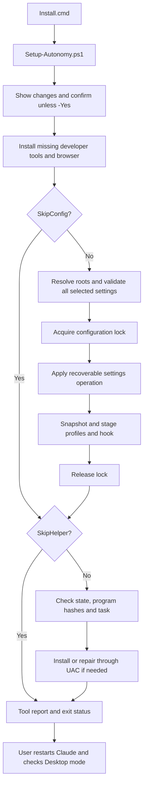
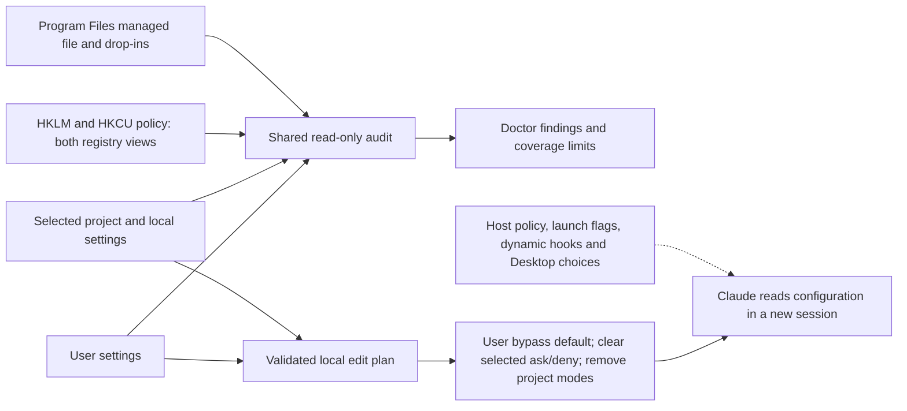
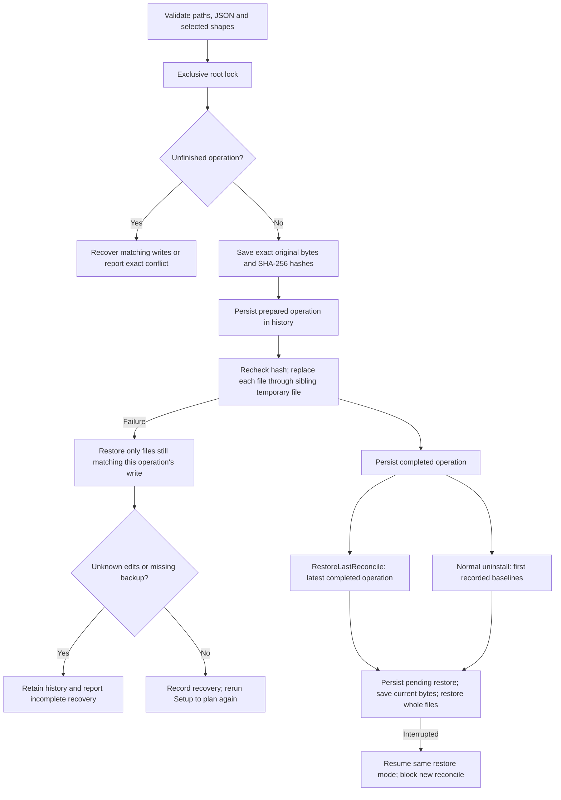
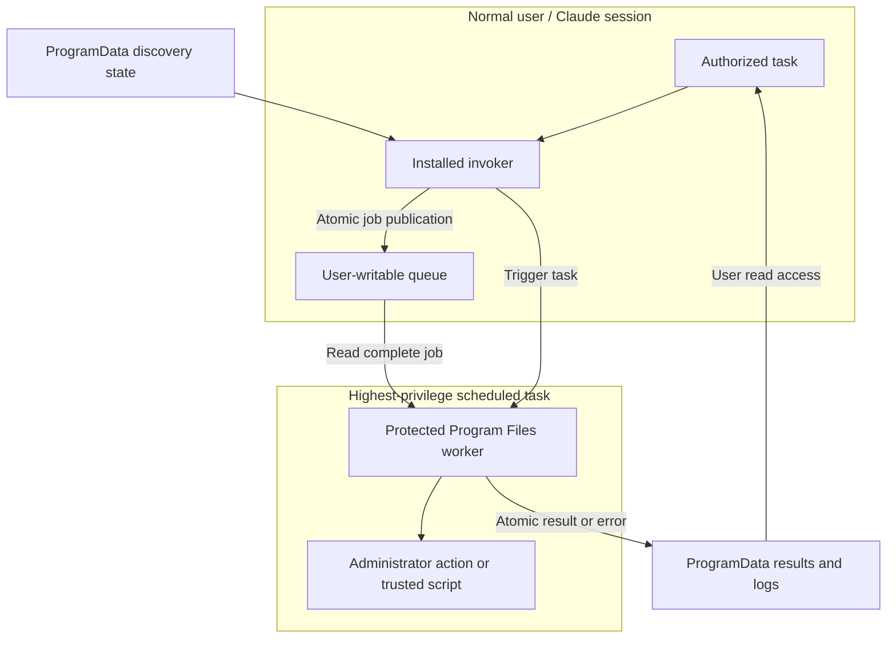

# Architecture

Claude Code Windows Autonomy Kit v2.0.0 is a set of Windows PowerShell scripts. It configures Claude Desktop's Code tab and the local CLI; it is not a Claude runtime, Cowork VM extension or permission-enforcement replacement.

## Components and scope

| Component | Responsibility |
|---|---|
| `Install.cmd` | Launch Setup under Windows PowerShell, forward arguments and preserve exit status |
| `Setup-Autonomy.ps1` | Tool bootstrap, settings merge, profile staging and helper install/repair |
| `lib/AutonomySettings.ps1` | Shared source inventory, read-only audit, validated plan, exact backups, lock, atomic writes and recovery |
| `Doctor-Autonomy.ps1` | Read-only settings/profiles/tools/helper dashboard and source-attributed restrictions |
| `Uninstall-Autonomy.ps1` | Latest-operation restore or baseline restore, profile cleanup and task removal |
| `elevated-dev-helper/` | Protected installed invoker/worker, scheduled task and administrator actions |
| `site/` | Published landing page source; no role in installed permission decisions |

## Installation flow

Setup is not one transaction over tools, settings, profiles and the helper. A later failure may leave completed earlier work installed. Settings operations have their own recovery guarantees described below. `-SkipBrowsers`, `-SkipConfig` and `-SkipHelper` select distinct steps; none implicitly disables the others.

The user root is resolved from nonempty `CLAUDE_CONFIG_DIR`, otherwise `%USERPROFILE%\.claude`. An explicit project selects only existing `.claude/settings.json` and `.claude/settings.local.json`. No recursive discovery occurs.

## Permission data flow

Only selected user/project files enter the write plan. Managed sources are report-only even when technically writable. `-SkipBypass` preserves mode keys; `-SkipClearBlockingRules` preserves existing ask/deny lists. Allow rules, unrelated values and foreign hooks survive. User notification wiring remains part of configuration; projects do not receive that hook. Semantic no-ops retain original bytes and do not add a settings operation.

Audit findings describe configured rules and potential restrictions, not observed runtime failures. The highest inspected local scalar mode is only a local calculation: uninspected runtime and managed inputs prevent a universal effective-permissions guarantee.

## Settings write and recovery

The lock is `<config-root>\.autonomy-kit.settings.lock`, outside staging, and covers configuration/history and staging cleanup. Its empty file can remain after uninstall; an existing file is not proof of an active lock. History is `<config-root>\autonomy-kit\settings-history.json`; exact backups live in its `recovery` directory. Per-file replacements are atomic, but the multi-file operation is not a single filesystem transaction. Hash checks preserve concurrent changes rather than overwriting unknown bytes.

Existing pre-kit snapshots remain the original user baseline. Project baselines are recorded at first touch. Restore verifies backup hashes and saves later edits before restoring entire files; originally absent targets are removed only while matching the kit's write. Missing/corrupt backups, moved projects and unknown edits retain recovery state. `-WhatIf` does not write backups, history or locks. Legacy installs without snapshots use a narrow settings-strip fallback; see the [user manual](USER-MANUAL.md#undo-settings-or-uninstall).

Profiles use a separate ownership model: compare live bytes with the prior staged kit copy, update unchanged kit-owned files, and preserve customized files. Settings recovery does not promise transactional rollback of profile/tool/helper steps.

## Elevated helper trust boundary

Programs default to `%ProgramFiles%\ClaudeElevatedHelper`; data defaults to `%ProgramData%\ClaudeElevatedHelper`. Discovery state always stays at `%ProgramData%\ClaudeElevatedHelper\install-state.json`, including when data lives elsewhere. Recorded custom paths survive repair. The installer verifies ACLs and administrator execution. The user may modify queue files, but has read access to results/logs/state and cannot ordinarily replace protected executable files.

This boundary protects the elevated engine from ordinary replacement. It does **not** sandbox submitted scripts: trusted user-script roots are `C:\dev\` and the task user's `Documents\Claude\`, with lexical checks and their documented reparse-point limitation. Code submitted there may have full administrator effects. Task authorization remains the owner's responsibility.

The worker processes serially, atomically publishes results, and drains arrivals until the queue looks empty. The task uses `IgnoreNew`; a job arriving between the final empty check and task exit may require another trigger. A result file alone is not success: check status, child exit code and the requested effect. See [helper documentation](../elevated-dev-helper/README.md).

## Evidence boundary

Regression tests exercise extracted production functions in temporary roots and mock external system effects where needed. A separate existing-machine uninstall/install/Doctor/helper walkthrough succeeded. CLI mode initialization was observed, but authentication prevented file actions. Desktop runtime and clean-machine installation remain unverified. See [verification evidence](IMPLEMENTATION-EVIDENCE.md), [test plan](../tests/TEST-PLAN.md) and [developer manual](DEVELOPER-MANUAL.md).
